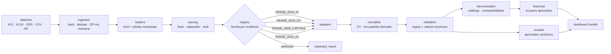

# Arquitetura e manual da pipeline

## Fluxo



## Etapas

| Etapa | Módulo | Entrada → saída | Falha isolada? |
|---|---|---|---|
| Descoberta | `ingestion/discovery.py` | `data/raw` → itens únicos + inventário | sim (arquivo ilegível vira `ING002`/`ING004`) |
| Leitura | `ingestion/readers.py` | bytes → `Grid` (valores + mesclagens) | sim (`ING010`) |
| Título/rodapé | `parsing/title.py` | `Grid` → `TitleInfo` com método de cada campo | — |
| Seleção de família | `adapters/registry.py` | `TitleInfo` + `Grid` → adaptador ou `ADP000` | sim |
| Extração | `adapters/base.py` + `families.py` | aba → registros canônicos | sim (`ADP900`) |
| Normalização | `standardization/normalize.py` | CV anexado, `VAL010`, erro-padrão derivado | — |
| Validação | `validation/rules.py` | registros → alertas + `validation_status` | — |
| Harmonização | `harmonization/*.py` | catálogo e pares avaliados | — |
| Série | `historical/series.py` | pares aprovados → pontos e variações | — |
| Exportação | `exports/*.py`, `reporting/reports.py` | CSV/JSON/MD | — |

## Execução

```bash
python scripts/run_pipeline.py      # ou: pip install -e . && pense-pipeline
python scripts/run_pipeline.py -v   # log detalhado no console
```

Código de saída `1` se algum arquivo não pôde ser lido ou algum adaptador falhou;
`0` caso contrário (alertas de qualidade não alteram o código de saída).

## Reprodutibilidade e idempotência

* IDs determinísticos (`observation_id` = hash de arquivo + aba + linha + coluna);
* ordenação estável de todas as saídas; duas execuções sobre os mesmos arquivos geram
  CSVs idênticos byte a byte (teste `test_run_is_idempotent`);
* `data/processed/run_manifest.json` registra hash de cada entrada, versões de Python e
  bibliotecas, contagens, verificações por regra e hash do pacote do painel;
* nenhum caminho absoluto: tudo é relativo à raiz (`config/settings.toml`).

## Logs

`logs/pipeline.jsonl` (JSON Lines): `ts`, `level`, `logger`, `msg` e campos de contexto
(`source`, `rule`…). O console mostra o resumo legível.

## Configuração externa (`config/`)

| Arquivo | Uso |
|---|---|
| `settings.toml` | caminhos, limites de ingestão, tolerâncias e limiares de validação |
| `vocabulary.toml` | rótulos de medida, dimensões, totais, rodapés |
| `territories.csv` | códigos IBGE, tipos, aliases e escopos de território |
| `symbols.csv` | símbolos do IBGE e tratamento |
| `editions.csv` | metadados de cada edição |
| `indicator_labels.csv` | rótulos curtos exibidos no painel |
| `comparability_candidates.csv` | pares candidatos entre edições (definidos por pessoa) |
| `comparability_decisions.csv` | decisões humanas com justificativa |
